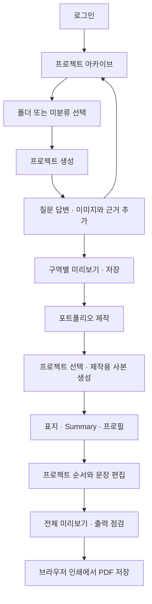
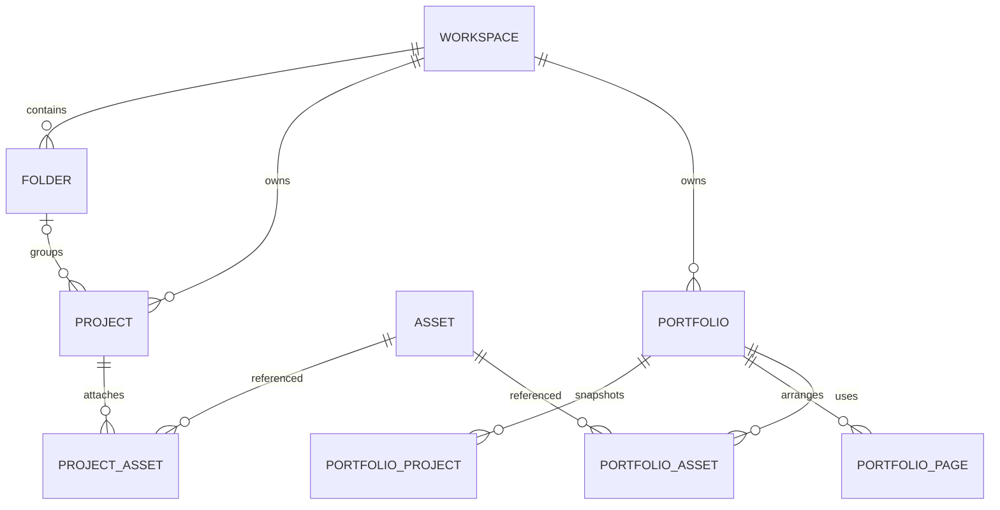

# portfolio_zip — PRD + 개발 스펙 통합문서

**버전:** v0.7 · 2026.10.13 (v0.6 대비 변경: F16 "AI로 초안 채우기" 추가(사용자가 자기 AI에서 받은 결과를 붙여 넣는 방식이며 이 서비스는 AI를 부르지 않음). v0.5 대비 변경: 8.2에 포트폴리오 편집 화면의 사이드바 닫힘 시작·편집 미리보기 통일·작성 위치 강조 추가, 8.3 프로필에 자격증 추가, 8.1에 마이페이지(S10)·10.1에 `my_profile`·11장에 `/api/me/profile` 추가, 8.2의 단계·진행률을 오른쪽 미리보기 카드로 통합. v0.1 대비 변경: 로그인을 Google 로그인만 사용하도록 F01·F14·12장·16장 수정, 로그인 없이 써 보기 허용(F01 수정, F15 추가: 로그인한 사용자와 같은 화면, 저장만 되지 않음), 이미지는 브라우저에서 줄여서 업로드(7.5 보완))  
**목적:** 서비스 기획 심화 개인과제 및 바이브코딩 MVP 구현 기준  
**가칭:** portfolio_zip · 브랜드·도메인 확정 전  
**제품:** 경험을 프로젝트 파일로 정리하고, 선택한 경험을 포트폴리오로 구성하는 웹서비스  
**초기 사용자:** 기획·PM 직무 지원자. 장기적으로 다른 직무의 템플릿 확장을 고려한다.

## 문서 사용 규칙

- 사용자가 지정한 제품 방향은 **요구사항**으로 반영한다. 나머지 설계·기술·수치 목표는 **이번 문서의 제안 기본값**이며 사용자 확정으로 간주하지 않는다.
- 참조 PDF는 구조와 표현 방식의 참고자료다. 내부 권장사항·홍보 문구를 구현 지시나 검증된 시장 사실로 취급하지 않는다.
- 사용자의 추가 답변에 따라 프로젝트 구조는 **PM 취업 로드맵 13~14쪽의 9개 항목**을 기준으로 확정한다. ‘역할·Contribution’을 별도 추가하고 각 구역에 이미지 첨부 자리를 제공한다. `image.png`를 다시 받아야 진행할 수 있는 의존성은 없다. 첨부 포트폴리오는 표지·Summary·프로필과 시각 배치만 참고한다.
- **P0:** MVP 출시 필수. **P1:** 핵심 흐름 검증 후 추가. **P2:** 확장 검토. 개발 중 P1/P2 기능을 임의로 P0에 추가하지 않는다.
- 본 문서는 구현 명세이며 서비스가 개발·배포·검증되었다는 의미가 아니다. 패키지 버전은 구현 시작 시 공식 문서를 확인하고 잠금 파일에 고정한다.

## 1. 프로덕트 오버뷰

### 1.1 제품 정의

사용자는 회사·인턴·활동 단위의 폴더 아래에 프로젝트를 파일처럼 보관한다. 프로젝트를 열면 질문과 예시를 따라 경험을 입력하고, 답변이 포트폴리오의 어느 구역에 들어갈지 확인한다. 이후 프로젝트를 선택하고 표지·Summary·프로필을 더해 제출용 포트폴리오를 만든다.

**핵심 가치:** 경험을 남기는 과정이 포트폴리오의 재료를 만드는 과정으로 연결된다.

‘파일’은 프로젝트의 시각적 표현이다. 앱의 저장 단위는 데이터베이스 레코드와 첨부 이미지이며, 컴퓨터의 실제 폴더를 자동 생성하지 않는다. `.zip` 다운로드는 가칭만으로 약속하지 않는다.

### 1.2 배경과 핵심 데이터

| 근거 | 확인 내용 | 제품 설계 시사점 |
|---|---|---|
| 자체 설문, 경험 보유자 n=25 | 21명(84.0%)이 최근 경험을 종료 후 1개월 이내 정리하지 않음 | 기록 시작 부담을 낮출 필요 |
| 자체 설문, 지연·미정리자 n=21 | 13명(61.9%)이 기록 내용 또는 좋은 기록의 기준을 몰랐음 | 질문·예시·누락 확인 |
| 자체 설문, 작성 경험자 n=20 | 19명(95.0%)이 기억·근거 부족 어려움 보고 | 경험과 근거 연결 |
| 동일 작성자 | 참고 자료·핵심 수치 어려움 15명(75.0%), 당시 자료 검색 17명(85.0%) | 이미지·자료 위치 보관 |
| 동일 작성자 | 근거 없이 작성한 경험 14명(70.0%) | 수치가 없는 경우의 표현 안내 |
| 동일 작성자 | 작성 기준 없음 9명(45.0%), 시간 과다 7명(35.0%) | 답변과 출력 구역 연결 |
| 경험 보유자 n=25 | 노션 사용 경험 19명(76.0%), 기획·PM 23명(92.0%) | 익숙한 문서 탐색 UI, 초기 직무 집중 |
| 기업·공고 조사 | 직무 관련성과 성과 평가, 일부 공고의 역할·성과 명시 요구 | 역할·기여와 결과를 분리해 표현 |

출처와 전체 분석은 [최종 리서치 보고서](./최종_리서치_보고서.md) 참조. 자체 설문(2026-10-06~07, 응답 26명)은 소규모 기획·PM 중심 표본이며, 위 수치는 2026-10-08 현재 응답 시트 기준으로 갱신했다. 일반 취준생 발생률로 제시하지 않는다. 기록 시점별 비교에서 늦은 정리가 어려움을 증가시킨다는 차이를 확인하지 못했다. 제품은 그 인과관계를 전제로 하지 않는다.

### 1.3 목표와 성공 지표

**사용자 목표:** 경험을 잊기 전에 최소한의 정보를 남기고, 작성 시 역할·판단·성과와 근거를 빠르게 찾아 활용한다.

**제품 목표:** 한 프로젝트 기록부터 제출용 포트폴리오 미리보기까지 한 제품 안에서 연결한다.

| 지표 | 정의·분모 | 초기 검증 기준(제안) |
|---|---|---|
| 첫 가치 도달 | 첫 프로젝트 생성 후 핵심 5개 필드 입력 및 프로젝트 미리보기 확인 / 프로젝트 생성 신규 사용자 | 사용성 평가 5명 중 4명 이상, 도움 없이 달성 |
| 기록에서 제작 전환 | 기록 프로젝트 1개 이상인 사용자 중 포트폴리오에 프로젝트를 추가한 비율 | 베타 2주간 기초값 측정 후 목표 설정 |
| 작성 부담 | 같은 유형의 프로젝트 정리 과제 완료 시간, 추가 자료 탐색 횟수 | 기존 방식 대비 변화 측정. 임의의 절감률 약속 없음 |
| 근거 활용 | 결과에 수치·정성 근거·산출물 중 하나를 연결한 프로젝트 / 완료 처리 프로젝트 | 기준값 측정 후 개선 확인 |
| 안전 지표 | 저장 실패, 데이터 유실, 다른 사용자 접근, 인쇄 잘림 | 사용자 간 접근·재현 가능한 데이터 유실 0건, P0 결함 해소 |

‘핵심 5개 필드’는 프로젝트명, 역할, 문제, 직접 행동, 결과 상태와 결과 설명이다. 이 기준은 입력 누락 확인 기준이며 포트폴리오 품질 점수가 아니다. 전체 섹션 입력률로 합격 가능성을 표현하지 않는다.

## 2. 사용자와 타깃 선정

### 2.1 가설 페르소나

| 구분 | 핵심 사용자 A — 작성 단계 | 보조 사용자 B — 경험 축적 단계 |
|---|---|---|
| 상황 | 기획·PM 지원을 준비하며 프로젝트 경험이 있으나 자료가 흩어져 있음 | 인턴·교육·개인 프로젝트를 진행하며 기록을 미룸 |
| 필요 | 무엇을 넣을지 판단하고, 역할·결과를 정리해 제출 문서 제작 | 짧게 남겼다가 나중에 보완 |
| 장애 | 수치 부족, 팀 기여 구분, 기준과 디자인 부담 | 기록 귀찮음, 무엇을 쓸지 모름 |
| 핵심 행동 | 폴더 정리 → 질문 답변 → 프로젝트 선택 → 제작 | 프로젝트 생성 → 최소 기록 → 이어 쓰기 |

설문에서 도출한 가설 페르소나다. 나이·성별·학력·신입 여부를 조사 결과로 창작하지 않는다.

### 2.2 선정 이유와 확장

기획·PM 응답이 21/23명으로 가장 많고 제공된 로드맵도 PM의 문제 해결 과정을 강조하므로 초기 템플릿을 집중한다. 다른 직무보다 문제가 크다는 비교 결과는 아니다. 데이터 구조에서 `template_key`와 버전을 분리해 이후 디자인·마케팅 등 템플릿을 추가할 수 있게 하되, MVP 화면에는 기획·PM 템플릿 하나만 제공한다.

### 2.3 핵심 사용자 과업

- 경험이 끝났을 때, 나중에 설명할 역할·행동·결과를 간단하게 남긴다.
- 수치가 없을 때, 확인할 수 있는 정성 근거나 산출물로 결과를 설명한다.
- 지원 준비 시, 필요한 프로젝트와 소개 정보를 골라 포트폴리오를 구성한다.

## 3. 문제 우선순위와 해결 가설

### 3.1 Impact·Effort 산정

Impact는 해결 시 ‘활용 가능한 경험 기록 → 포트폴리오 제작’에 미치는 효과를 1~5로 평가한다. 1은 보조 편의, 3은 한 단계의 의미 있는 개선, 5는 핵심 가치 실현에 필수다. Effort는 문제 자체가 아니라 **해당 대응안을 구현·검증하는 부담**이다. 1은 독립적인 작은 작업, 3은 여러 화면·데이터 연동, 5는 외부 의존·복잡한 출력·정확성 검증을 포함한다. `I/E`는 비교 보조값이다. 아래 점수는 PM 추정이며 조사 통계나 개발 견적이 아니다.

| 문제 | 대응안 | I | E | I/E | 판단 |
|---|---|---:|---:|---:|---|
| 무엇을 쓰고 어떻게 설명할지 모름 | 질문·예시·현재 구역 강조 | 5 | 3 | 1.67 | P0, 핵심 |
| 수치와 근거가 부족함 | 결과 유형·정성 대체 가이드·이미지/링크 | 5 | 3 | 1.67 | P0, 핵심 |
| 개인 역할과 팀 성과 혼재 | 역할·직접 행동·기여 구분 | 4 | 2 | 2.00 | P0, 핵심 |
| 경험·자료가 흩어짐 | 폴더·프로젝트·근거 연결 | 4 | 3 | 1.33 | P0, 기반 |
| 문서 구조·형식 제작 부담 | 정해진 템플릿과 포트폴리오 조립 | 4 | 5 | 0.80 | P0, 제품의 최종 가치이므로 포함 |
| 계속 기록하지 않음 | 정기 알림·자동 수집 | 3 | 4 | 0.75 | P1/P2, 습관 효과 미검증 |
| 직무별 표현이 어려움 | AI·JD 맞춤 작성 | 3 | 5 | 0.60 | P2, 사실 왜곡·외부 의존 검증 필요 |

보안·저장 안정성은 위 점수와 무관한 필수 조건이다. 낮은 I/E만으로 포트폴리오 제작을 제외하지 않는다.

### 3.2 핵심 문제와 가설

**핵심 문제:** 경험은 있지만 역할·판단·결과와 근거를 포트폴리오에 활용할 형태로 정리하기 어렵다.

| 가설 | 제안 개선안 | 검증 |
|---|---|---|
| 질문과 출력 위치를 함께 보면 작성 기준을 이해한다 | 단계별 질문 + 같은 구역의 미리보기 강조 | 사용자가 각 답변의 용도를 설명하고 핵심 필드 완성 |
| 수치 이외의 근거 안내가 기록 포기를 줄인다 | 정량·정성·산출물·미검증 상태 선택 | 수치 없는 사례에서 사실에 기반한 결과 입력 가능 |
| 경험 원본과 제출용 문서를 분리하면 재활용이 쉬워진다 | 원본 보관 + 제작본 스냅샷 | 제작본 수정 후 원본이 보존되고 다른 제작본 생성 가능 |

**이번 버전의 최종 제안안:** 폴더형 프로젝트 아카이브, 질문형 프로젝트 편집, 구역별 미리보기, 근거 기반 결과 작성, 별도 포트폴리오 제작 공간. 서비스 효과가 입증된 최종안이라는 뜻은 아니다.

## 4. 범위

| P0 — MVP | P1 — 다음 개선 | P2 — 장기 확장 |
|---|---|---|
| Google 로그인, 개인 워크스페이스 | 프로젝트 복제·검색 고도화 | 다른 직무 템플릿 |
| 폴더·프로젝트 생성/이름 변경/이동/휴지통 | 일괄 백업·가져오기·ZIP 패키지 | AI 질문·교정·JD 맞춤 |
| 질문형 입력·예시·수치 대체 안내 | 기록 리마인더 | 협업·멘토 피드백 |
| 이미지·캡션·근거 URL | 추가 템플릿·자유 배치 | 외부 문서 자동 수집 |
| 자동 저장·다시 열기·충돌 안내 | 버전 기록·변경 비교 | 공개 웹 포트폴리오·공유 링크 |
| 표지·Summary·프로필(교육·도구·경력) | PPTX 내보내기 | 결제·구독 |
| 프로젝트 선택·순서 조정·개별 제작본 편집 | 전용 서버 PDF 생성 | 채용 지원·이력서 관리 통합 |
| 비공개 미리보기·브라우저 PDF 저장 안내 | 사용자 맞춤 출력 규격 | 자유 캔버스·디자인 에디터 |

표지·Summary·프로필은 최소 입력형으로 P0에 포함한다. 독립적인 이력서 제작 서비스는 범위 밖이다. 실제 ZIP 다운로드, 공개 링크, 결제는 MVP 약속에 포함하지 않는다. 이 서비스가 직접 호출하는 생성형 AI(질문·교정·JD 맞춤 등)는 P2로 둔다. 다만 F16은 사용자가 자기 AI에서 받은 결과를 붙여 넣는 방식이라 서버·API 키·요금 없이 P0에 포함한다(2026-10-13 사용자 결정).

## 5. 정보 구조와 사용자 흐름

### 5.1 메뉴와 폴더 구조

```text
portfolio_zip
├─ 프로젝트 아카이브
│  ├─ 미분류
│  │  └─ 개인 서비스 개선 프로젝트 [프로젝트 파일]
│  ├─ A회사 · 기획 인턴 [폴더]
│  │  ├─ 온보딩 개선 [프로젝트 파일]
│  │  └─ 사용자 조사 [프로젝트 파일]
│  └─ 서비스 기획 교육 [폴더]
│     └─ 구매 전환 개선 [프로젝트 파일]
├─ 포트폴리오 제작
│  └─ 지원용 포트폴리오 [제작본]
│     ├─ 표지
│     ├─ Summary
│     ├─ 프로필
│     └─ 선택한 프로젝트 페이지
└─ 휴지통 / 설정
```

폴더는 조직·활동 단위이며 프로젝트가 하위 항목이다. MVP는 **폴더 1단계 + 프로젝트**만 지원한다. 중첩 폴더·실제 파일 경로·사용자 파일시스템 접근은 없다. 미분류는 `folder_id=null`의 가상 폴더이며 삭제할 수 없다. 폴더 이름은 자유 입력하고 회사뿐 아니라 동아리·교육·개인 활동도 허용한다.

### 5.2 주요 흐름



저장과 다음 단계 이동은 작성 완료 여부에 묶지 않는다. 사용자는 중간에 나가고 마지막 편집 위치로 돌아올 수 있다. 원본 경험이 없어도 제작본 틀을 만들 수 있으나 프로젝트 없는 출력은 제한한다.

### 5.3 저장 원칙

- 경험 원본은 축적용이다. 제작본은 지원 목적에 맞게 수정하는 별도 사본이다.
- 프로젝트 추가 시 답변·표시 이미지·근거·템플릿 버전을 제작본으로 복사한다. 원본 변경이 제작본을 자동 덮어쓰지 않는다.
- ‘원본에서 다시 가져오기’는 해당 프로젝트 사본을 교체하며, 덮어쓰일 편집 내용 안내와 확인 후 실행한다. MVP는 부분 병합하지 않는다.
- 프로젝트 제외는 제작본 사본만 제거한다. 경험 원본은 유지한다.
- 표지·프로필·Summary는 제작본별 저장. 프로젝트 아카이브와 혼합하지 않는다.

## 6. 기능명세와 인수 조건

| ID | 기능 | P | 동작 및 인수 조건 |
|---|---|---|---|
| F01 | 로그인·로그아웃 | 0 | Google 로그인만 지원한다(처음 로그인하면 가입이 함께 이뤄지고, 이메일·비밀번호 가입과 비밀번호 재설정은 만들지 않는다). 로그인은 저장이 필요한 순간에만 요구한다(F15). 로그인하지 않은 사용자는 저장된 개인 데이터와 API에 접근할 수 없다. 로그아웃 시 개인 캐시 제거 |
| F02 | 폴더 관리 | 0 | 생성·이름 변경. 이름 1~60자. 빈 폴더 휴지통 이동. 비어 있지 않으면 ‘미분류로 이동 후 삭제’ 확인; 프로젝트 연쇄 삭제 금지 |
| F03 | 프로젝트 관리 | 0 | 이름·폴더·기간·유형 입력. 생성은 제목만 필수. 제목 1~80자. 이동 메뉴로 다른 폴더 이동. 동일 이름 허용, UUID로 식별 |
| F04 | 질문형 경험 편집 | 0 | 아래 필드와 가이드 노출. 단계 앞뒤 이동·직접 점프. 미입력 상태에서도 저장·이동 가능 |
| F05 | 결과 대체 작성 | 0 | 결과 유형 선택에 따라 질문 변경. 실제와 목표·계획을 별도 표시. 가상의 수치 자동 생성 금지 |
| F06 | 이미지·근거 | 0 | JPEG/PNG/WebP 업로드, 캡션·대체텍스트·구역 지정·순서·삭제. 근거 URL과 설명 입력. 실패 시 텍스트 답변 유지 |
| F07 | 자동 저장·복구 | 0 | 마지막 입력 후 1초 저장 시도. 저장 중/완료/실패 표시. 재접속 시 서버 확인 버전 로드. 충돌 시 자동 덮어쓰기 금지 |
| F08 | 구역별 프로젝트 미리보기 | 0 | 현재 필드와 연결된 출력 구역을 강조. 빈 구역은 편집용 윤곽·라벨 표시. 출력에는 빈 구역과 가이드 미포함 |
| F09 | 포트폴리오 관리 | 0 | 제목으로 생성·이름 변경·휴지통 이동. 프로젝트 선택 및 추가. 기본 페이지 배열 생성 |
| F10 | 표지·Summary·프로필 | 0 | 별도 제작 메뉴에서 입력. Summary 항목이 프로젝트 사본과 연결됨. 교육·경력·자격증·툴은 반복 입력·순서 조정. 마이페이지의 프로필을 불러오면 제작본에 복사되며 이후 서로 영향을 주지 않는다 |
| F11 | 제작본 편집·순서 | 0 | 프로젝트 사본 문장 편집·섹션 표시·이미지 선택. 위/아래 버튼 제공. 편집해도 원본 불변 |
| F12 | 미리보기·PDF 저장 | 0 | 출력 전 누락·overflow·이미지 로딩 검사. 인쇄 페이지로 이동하고 PDF 저장 안내. 파일 저장 성공을 자동 주장하지 않음 |
| F13 | 휴지통·복원 | 0 | 프로젝트·제작본 소프트 삭제, 30일 보관. 복원 시 원폴더 없으면 미분류. 영구 삭제는 별도 확인 |
| F14 | 데이터 삭제·계정 탈퇴 | 0 | Google로 다시 로그인해 본인을 확인한 뒤 모든 개인 레코드·첨부 삭제 요청. 처리 중/완료/실패 상태. 외부 저장 PDF는 삭제 대상 아님 |
| F16 | AI로 초안 채우기 | 0 | 프로젝트 편집 화면에서 "AI로 채우기"를 누르면 (1) 이 서비스가 만든 지침을 복사하고 (2) 사용자가 그 지침을 자기 AI(ChatGPT·Claude 등)에 붙여 넣고 기획서·PRD PDF를 직접 첨부해 보낸 뒤 (3) AI가 준 결과(JSON)를 붙여 넣으면, **비어 있는 칸에만** 10단계 초안을 채운다. 사용자가 이미 쓴 칸은 바꾸지 않고 목록(기여·근거·지표)은 비어 있을 때만 통째로 넣는다. 지침은 문서에 없는 내용·숫자·성과·기여율·근거 링크·지표의 실제 값을 만들지 말고 계획 단계 문서의 결과를 달성한 것으로 쓰지 말라고 요구하며, 붙여 넣은 결과는 글자 수·기간 형식·선택값을 검증해 어긋나면 비운다. 이 서비스는 문서를 받거나 AI를 부르지 않는다(브라우저에서만 처리, 서버·API 키·요금 없음). 안내 창은 "문서는 내가 고른 AI로 올라간다, 개인·회사 내부 정보는 가려 달라, AI가 틀릴 수 있다"를 알리고, 채운 뒤 "AI 초안이니 확인해 달라"를 알린다. 로그인 없이 써 보는 화면에서도 쓸 수 있고(F15), 채운 내용은 평소 입력처럼 저장된다(로그인한 경우) |
| F15 | 로그인 없이 써 보기 | 0 | 로그인하지 않아도 시작 화면, 첫 방문 안내, 프로젝트 아카이브, 경험 편집 화면, 개인정보 안내를 로그인한 사용자와 **같은 화면**으로 쓸 수 있다. 폴더·프로젝트 만들기, 이름 변경, 폴더 이동, 질문 입력, 미리보기까지 직접 해 볼 수 있다. 샘플 데이터는 보여 주지 않고 처음 로그인한 사용자처럼 빈 보관함에서 시작한다. 다만 만든 내용은 브라우저 메모리에만 있고 **서버에 저장되지 않는다**(새로고침하거나 창을 닫으면 사라지고, 로그인 과정에서도 사라진다). 화면 곳곳에서 "저장되지 않아요"를 밝히고, 내용이 있는 채로 창을 닫으려 하면 경고하며, "저장"을 누르면 "저장하려면 로그인이 필요해요" 안내를 띄워 Google 로그인으로 보낸다. 이미지 첨부는 저장소가 필요하므로 로그인한 뒤에만 쓴다. 서버 API와 DB는 이 화면에서도 로그인 여부를 다시 검사한다 |

폴더 삭제·영구 삭제·원본 다시 가져오기는 앱 안에서 명확한 확인 UI를 제공한다. 구현 과정에서 사용자의 실제 자료를 예시 데이터로 자동 가져오지 않는다.

## 7. 프로젝트 질문·필드·가이드

### 7.1 기본 구조와 단계

**프로젝트 기본 순서:** 프로젝트 개요 → 역할·Contribution(추가) → 문제 정의 → 데이터 및 근거 → 핵심 인사이트 → 가설 → 해결안 → 성공 지표 → 실행 계획 → 회고. 로드맵 원래 9개 항목의 상대 순서를 유지한다. 실제 결과는 성공 지표 항목의 하위 영역으로 추가하고, 결과 상태·회고와 연결한다. 이미지 첨부는 별도 작성 단계가 아니라 각 항목에서 가능하다.

| 편집 단계 | 섹션 키 | 입력과 질문 | 출력 위치 |
|---|---|---|---|
| 1. 프로젝트 개요 | `overview` | 어떤 서비스·경험인가요? 어떤 문제를 다루며 왜 선택했나요? 기간·유형은? | 소개 페이지 개요·선정 이유 |
| 2. 역할·Contribution | `role`, `contribution` | 무엇을 맡았나요? 직접 한 일과 공동 수행한 일은? | 소개 페이지 역할, 실행 페이지 기여 카드 |
| 3. 문제 정의 | `problem` | 어떤 현상이 누구에게 발생했나요? 사용자·비즈니스에 왜 중요한가요? | 분석 페이지 Problem |
| 4. 데이터 및 근거 | `evidence` | 어떤 데이터·VOC·관찰을 봤나요? 출처와 범위는? | 분석 페이지 Research & Evidence |
| 5. 핵심 인사이트 | `insight` | 발견한 패턴과 불편은? 현재 근거만으로 단정하기 어려운 점은? | 분석 페이지 Insight |
| 6. 가설 | `hypothesis` | 왜 문제가 생긴다고 생각하나요? 어떤 개선으로 어떤 행동 변화를 예상하나요? | 분석 페이지 Hypothesis |
| 7. 해결안 | `solution` | 무엇을 개선했고 왜 선택했나요? 다른 대안보다 우선한 이유는? | 실행 페이지 Solution |
| 8. 성공 지표 | `metrics`, `result` | 성공·중간·부작용·정성 지표는? 실제 결과 또는 미검증 계획은? | 실행 페이지 목표 지표, 결과 페이지 Result |
| 9. 실행 계획 | `execution` | 어떤 순서로 진행했거나 진행할 건가요? 협업·검증 방법은? | 실행 페이지 Execution |
| 10. 회고 | `reflection` | 한계·배운 점·추가 데이터·다음 단계는? | 결과 페이지 Reflection |

다음/이전은 입력 순서 제안이며 강제 제출 단계가 아니다. 첫 기록에서는 제목·역할·문제·직접 행동·결과 상태만 먼저 남기고 나머지는 나중에 보완할 수 있다.

### 7.2 필드 계약

단일 텍스트 2,000자, 간단 소개 300자, 짧은 제목 80자. 글자 수 제한은 저장 가능한 상한이며 그 길이가 한 출력 페이지에 들어간다는 뜻은 아니다. 입력 화면은 글자 수와 출력 초과 상태를 각각 표시한다. 문자열 앞뒤 공백은 검증에만 제거하고 내부 줄바꿈을 보존한다. 초안은 빈 값 허용.

| 키 | 형태 | 필드 | 안내·회색 예시(모두 가상 예시) |
|---|---|---|---|
| overview | 객체 | `oneLine`, `context`, `purpose`, `startMonth`, `endMonth`, `ongoing`, `projectType`, `teamSize` | ‘가입 이후 첫 행동까지의 흐름을 개선한 프로젝트’ |
| role | 객체 | `title`, `responsibility` | ‘사용자 인터뷰 설계와 온보딩 화면 기획을 맡았습니다.’ |
| problem | 객체 | `targetUser`, `phenomenon`, `importance` | ‘처음 가입한 사용자가 다음 행동을 찾기 어려워했습니다.’ |
| evidence | 배열, 최대 10개 | `kind`, `description`, `sourceUrl`, `observedAt`, `limitation` | ‘인터뷰에서 반복된 어려움과 관찰 범위를 적어주세요.’ |
| insight | 객체 | `pattern`, `interpretation`, `limitation` | ‘안내 부족을 의심했지만 원인으로 확정할 데이터는 없었습니다.’ |
| hypothesis | 객체 | `statement`, `expectedBehavior` | ‘다음 행동을 안내하면 첫 설정 완료가 늘어날 것으로 예상했습니다.’ |
| solution | 객체 | `selected`, `alternatives`, `reason` | ‘전체 개편보다 첫 단계 안내를 우선했습니다. 구현 범위가 작고 핵심 문제에 직접 대응하기 때문입니다.’ |
| execution | 객체 | `steps`, `collaboration`, `status` | 상태: planned / in_progress / completed. ‘기획안을 만들고 프로토타입에서 사용 흐름을 확인했습니다.’ |
| contribution | 배열, 최대 10개 | `task`, `ownership`, `detail`, `percentOptional` | ownership: lead / joint / support. ‘인터뷰 질문지 설계: 주도 / 프로토타입: 공동 제작’ |
| metrics | 배열, 최대 6개 | `name`, `purpose`, `baseline`, `target`, `unit`, `measurementPlan`, `actualOptional` | purpose: primary / supporting / guardrail / qualitative. ‘검증 예정: 첫 설정 완료율, 측정 방법: 테스트 과제 관찰’ |
| result | 객체 | `status`, `type`, `summary`, `facts`, `limits`, `nextValidation` | status: observed / not_measured / not_executed. type: quantitative / qualitative / deliverable / mixed |
| reflection | 객체 | `learning`, `limitation`, `nextStep`, `roleRelevanceOptional` | ‘이후에는 실제 이용 데이터를 추가해 가설을 확인하고 싶습니다.’ |

기간은 `YYYY-MM`, 종료 월은 시작 월 이상. 진행 중이면 종료 월은 null. 프로젝트 유형은 실제 업무 / 인턴 / 교육·과제 / 개인 / 기타. 유형과 실행 상태는 별개다. ‘실제 업무’ 유형이어도 검증 전일 수 있다.

### 7.3 역할·Contribution 규칙

- 역할은 직무·담당 범위, Contribution은 구체적인 수행 항목과 책임 수준이다.
- 팀 전체의 성과와 본인의 직접 수행 행동을 분리한다.
- 기여율은 선택 입력 0~100%. 분야별 책임 비율이며 합계 100%를 요구하지 않는다. 자동 추정하지 않는다.
- 비율 입력 시 ‘실측 또는 합의 근거가 없으면 책임 수준과 직접 한 일로 설명할 수 있어요’ 안내.
- 예: UI 기획 100%, 리서치 공동 수행 25%를 그대로 합산하거나 종합 기여율로 환산하지 않는다.

### 7.4 수치가 없을 때 가이드

| 상황 | 질문 | 출력 방식 |
|---|---|---|
| 검증된 수치 있음 | 어떤 값이 어느 기간·대상에서 측정됐나요? 출처는? | 단위·기간·범위를 함께 적은 실제 결과 |
| 정성 피드백 있음 | 누가 무엇을 어떻게 평가했나요? 관찰 범위는? | 정성 결과 라벨, 관찰한 사실과 한계 |
| 산출물 있음 | 무엇을 완성하고 어디까지 적용했나요? | 산출물·적용 범위. 사용자 효과를 자동 주장하지 않음 |
| 실행했지만 측정 안 됨 | 확인한 산출물과 측정하지 못한 효과는? | ‘효과 미측정’ 라벨 + 확인 사실 |
| 기획·과제로 미실행 | 목표·가설·검증 계획은? | ‘제안·검증 예정’ 라벨. 실제 개선으로 서술하지 않음 |

상단 설명: **‘수치가 없어도 정리할 수 있어요. 확인한 피드백, 완성한 산출물, 적용 범위를 쓰고 측정하지 않은 효과는 구분해 주세요.’**

회색 예시: ‘프로토타입과 화면 명세를 완성했습니다. 실제 사용자 전환율 변화는 아직 측정하지 않았습니다.’

숫자를 만들어 넣거나 불명확한 ‘효율 향상’을 강요하지 않는다. 추정값은 확인 사실과 분리해 텍스트에 추정임을 표시한다. UI 예시는 실제 값으로 저장하지 않으며 출력·완료 판정에서 제외한다.

### 7.5 이미지와 근거

- 각 섹션에 ‘이미지 추가’ 자리 제공. 대표 이미지 최대 1개 + 본문 이미지 전체 최대 12개/프로젝트.
- 첨부당 10MB, JPEG/PNG/WebP만 허용. 클라이언트 안내와 서버 MIME·실제 이미지 디코딩 검증 모두 적용. SVG·GIF·PDF 업로드는 P0 제외. 사용자는 10MB까지 원본을 고를 수 있고, 브라우저가 올리기 전에 4,096px·약 3.5MB 이하로 줄여서 보낸다(Vercel 함수 요청 본문이 4.5MB를 넘으면 거절되기 때문). 서버는 4MB를 넘는 요청을 413으로 거절하고, 받은 파일을 다시 검증·재인코딩한다.
- 업로드 시 4,096px 이하로 축소, 재인코딩하여 메타데이터 제거. 총 처리 후 첨부 용량 80MB/프로젝트, 계정 500MB 한도 제안.
- 캡션 150자, 대체텍스트 150자, 구역 키·정렬 순서 저장. 정보성 이미지에는 대체텍스트 필수; 장식용이면 explicit decorative 플래그.
- 미리보기는 `contain`, 비율 보존. 자유 크롭·이미지 편집은 제외. 제거는 화면·참조 데이터에서 먼저 제외하고 스토리지 정리는 재시도 가능한 작업으로 수행.
- 근거 URL은 http/https만 허용, 자동 미리보기 수집 없음. 제출 문서 포함 여부 별도 체크. 이름·연락처·회사 내부 정보 확인 안내를 업로드 영역에 제공.

## 8. 화면 명세와 UI 요구사항

### 8.1 화면 목록

| 화면 ID / 경로 | 구성 | 주요 행동 | 빈 상태·예외 |
|---|---|---|---|
| S00 `/` | 제품 소개, 시작하기 CTA | 로그인 | 실제 자료·가짜 성과 배너 없음 |
| S01 `/auth` | Google로 시작하기 버튼, 개인정보 처리 안내 링크 | 인증 | 로그인 취소·실패 안내, 허용되지 않은 계정(공개 전 테스트 사용자 한정) 안내 |
| S02 `/workspace` | 좌측 폴더 트리, 최근 프로젝트·파일 목록 | 폴더/프로젝트 생성·열기 | ‘첫 경험을 프로젝트로 정리해 보세요’ + CTA |
| S03 `/workspace/projects/:id` | 폴더 트리, 상단 프로젝트 정보·저장 상태, 단계 탭, 질문 폼, 미리보기 | 작성·근거 추가·단계 이동 | 로딩·없음·권한 없음·저장 실패 |
| S04 `/portfolios` | 제작본 파일 목록 | 생성·열기·휴지통 | 새 포트폴리오 만들기 |
| S05 `/portfolios/:id/edit` | 표지/Summary/프로필/프로젝트 페이지 목록, 제작용 입력, 미리보기 | 프로젝트 추가·순서·편집 | 아직 프로젝트 없음, 원본 업데이트 있음 |
| S06 `/portfolios/:id/preview` | 전체 페이지, 출력 점검 목록 | 편집 복귀·PDF 저장 시작 | 누락 경고·overflow·이미지 실패 |
| S07 `/portfolios/:id/print` | 인쇄 전용 콘텐츠·안내 | 브라우저 인쇄 | 편집 UI 미포함, 로딩 완료 전 인쇄 비활성 |
| S08 `/trash` | 삭제 항목·복원·영구 삭제 | 복원/삭제 | 휴지통 없음 |
| S09 `/settings` | 계정·용량·탈퇴 | 로그아웃, 계정 삭제 요청 | 삭제 처리 상태·실패 재시도 |
| S10 `/mypage` | 프로필(소개·교육·경력·자격증·도구) 입력. 포트폴리오 프로필에서 "마이페이지에서 불러오기"로 복사 | 입력·자동 저장 | 로그인 없이는 메모리에만 있고 저장되지 않음(F15). 저장한 적 없으면 빈 프로필 |

`:id`는 UUID. 요청 사용자 소유권을 항상 검증하고 외부 사용자에게 레코드 존재를 노출하지 않는 404 UI를 사용한다. S00~S03(와 첫 방문 안내)은 로그인 없이도 로그인한 사용자와 같은 화면으로 쓸 수 있고(F15), 이때 S02·S03의 내용은 저장되지 않는다. 저장된 실제 데이터와 S04~S10은 로그인한 뒤에 쓸 수 있다(S10은 로그인 없이도 같은 화면을 메모리에서 써 볼 수 있다).

### 8.2 경험 편집 화면

```text
┌──────────────┬────────────────────────────────────────────────────┐
│ portfolio_zip│ 온보딩 개선             저장됨     [미리보기]       │
│ 프로젝트 아카이브  ├────────────────────────────────────────────────────┤
│ ▾ A회사 인턴 │ 현재 3/10 문제 정의 [단계 선택]                    │
│   온보딩 개선├──────────────────────┬─────────────────────────────┤
│   사용자 조사│ 질문 / 도움 설명     │ 프로젝트 페이지 미리보기     │
│ ▸ 교육       │ [답변 입력]          │ [Problem] ← 현재 작성 구역   │
│ 미분류       │ [회색 예시]          │ [Research] [Insight]         │
│              │ [+ 이미지]           │ [관련 이미지 자리]           │
│ 포트폴리오   │ [이전] [다음]        │ 페이지 2 / 4                 │
└──────────────┴──────────────────────┴─────────────────────────────┘
```

- 1,280px 이상: 좌측 탐색 288px(2026-10-13 240px에서 넓힘. 안내 문구가 어색하게 줄바꿈되어서), 질문 영역 최소 360px, 미리보기 나머지. 상단 64px.
- 포트폴리오 편집 화면(S05)은 페이지 미리보기를 크게 보려고 1,280px 이상에서도 사이드바를 닫은 채로 시작한다. 사용자가 펼칠 수 있고, 그 선택은 기억하지 않으며 다른 화면으로 가면 평소 설정으로 돌아간다. 모든 편집 화면의 미리보기는 같은 출력 렌더러를 쓰고, 입력 칸에 포커스가 가면 그 칸이 들어가는 구역을 윤곽선과 "작성 위치" 글자로 강조한다(출력에는 나오지 않는다).
- 768~1,279px: 사이드바 접기, ‘작성/미리보기’ 탭 전환. 두 열을 무리하게 유지하지 않는다.
- 767px 이하: 서랍형 탐색, 단일 열 질문 폼, 단계 드롭다운, 미리보기 별도 탭. 기록·열람 지원; 세밀한 출력 조정은 PC 권장 안내.
- 필드 focus 시 대응 구역의 페이지로 이동하고 테두리·라벨 ‘지금 작성 중’을 표시한다. 색상만으로 구분하지 않는다. 입력 도중 반복 스크롤 점프 금지, 필드 focus 변경 시에만 이동.
- 빈 예시·placeholder는 저장 데이터가 아니다. 질문 라벨과 설명을 항상 남겨 입력 후에도 의미를 알 수 있게 한다.
- 단계는 10개이며 상단에 현재 위치와 이전·다음·전체 단계 선택을 제공한다. 10개 탭을 좁은 폭에 억지로 배치하지 않는다. ‘현재 4/10 단계’는 위치이며 품질·합격 점수가 아니다. ‘초안/기록 완료’는 사용자가 지정한다. 1,280px 이상에서는 현재 단계·진행 퍼센트 바·단계 선택을 오른쪽 미리보기 카드 맨 위에 모아 보여 준다. 퍼센트는 현재 단계의 위치(예: 3/10 → 30%)이며 입력 완성도나 품질 점수가 아니다.

### 8.3 표지·Summary·프로필

| 영역 | 입력 | 기본 출력 |
|---|---|---|
| 표지 | 이름(필수), 지원 직무, 한 줄 소개, 이메일·링크(선택), 이미지(선택) | 이름·직무·소개. 연락처는 포함 토글 기본 OFF |
| Summary | 1~5개 항목, 제목 100자, 설명 300자, 연관 프로젝트 사본 ID | 핵심 역량과 연결된 프로젝트 요약. 사용자가 직접 작성 |
| 프로필 | 소개 600자, 교육 최대 10개, 경력 최대 10개, 자격증 최대 10개, 도구 최대 20개. 마이페이지에 저장해 둔 프로필을 불러와 복사할 수 있다 | 교육·경력·자격증·도구의 분리된 영역. 빈 영역 숨김 |
| 자격증 | 이름(필수, 80자), 발급 기관(80자), 취득일(40자) | 취득일과 자격증 이름·발급 기관. 점수·등급 항목 없음 |
| 교육 | 기관·과정·기간·설명 | 기간과 교육명 |
| 경력 | 조직·역할·기간·설명 | 기간·조직·역할 |
| 도구 | 도구명·활용 설명(선택) | 이름·설명. 임의 숙련도 퍼센트 없음 |

Summary·프로필 페이지는 선택적 표시가 가능하다. 연결한 프로젝트를 제외하면 Summary 연결은 해제하고 문장은 유지한 뒤 사용자 확인 안내. 교육·툴·경력을 경험 답변의 필수 질문으로 끼워 넣지 않는다. 개인 연락처는 로그·분석 이벤트에서 제외한다.

## 9. 출력 템플릿과 포트폴리오 구성

### 9.1 페이지 규격

기본은 16:9 가로 페이지, 설계 캔버스 1,280×720, 인쇄 크기 320×180mm. 출력은 텍스트를 이미지로 평탄화하지 않는 HTML/CSS 인쇄 방식. 사용자 브라우저의 PDF 저장 기능을 활용한다. PPTX 편집 파일은 P1이다.

기본 순서: 표지 1장 → Summary(선택) → 프로필(선택) → 선택 프로젝트별 페이지. 첨부 포트폴리오의 실제 숫자·개인정보·브랜드 자산은 데모에 복사하지 않는다.

| 프로젝트 페이지 | 구역 |
|---|---|
| A 소개 | 프로젝트명·기간·유형·상태 / 개요·선정 이유 / 역할 / 대표 이미지 |
| B 분석 | Problem / Research & Evidence / Insight / Hypothesis |
| C 실행 | Solution / 대안과 선택 이유 / 목표·검증 지표 / Execution / Contribution / 이미지 |
| D 결과 | 성공 지표의 실제 결과 또는 검증 예정 상태 / Reflection / 직무 연결(선택) |

각 페이지는 구역 기반 템플릿이며 자유 좌표 이동은 없다. 단일 프로젝트가 반드시 1장에 들어가야 한다는 요구로 해석하지 않는다. ‘한 페이지의 어느 구역을 쓰는지’는 현재 페이지의 구역 미리보기로 구현한다.

### 9.2 출력 데이터 규칙

- 같은 렌더러를 편집 미리보기·전체 미리보기·인쇄 화면에서 공유한다.
- 콘텐츠는 plain text·구조화 배열로 저장하며 사용자 HTML을 실행하지 않는다. URL·줄바꿈은 안전한 렌더링 적용.
- 빈 섹션·빈 이미지 자리는 인쇄에서 숨긴다. 상태 라벨(미검증·제안)은 실제 데이터라 숨기지 않는다.
- 결과 없는 계획 프로젝트는 목표/검증 계획을 보여주고 ‘성과 달성’으로 바꾸지 않는다.
- 폰트·이미지 로딩 완료와 실제 렌더 높이 확인 후 출력 가능. overflow면 ‘내용 줄이기/이어지는 페이지 추가’ 제공. 이어지는 페이지는 동일 섹션 키와 연속 번호를 갖는다.
- 섹션 내 불릿·근거 항목을 경계로 분할하고, 긴 본문은 문단 경계로 분할한다. 단일 문단도 넘치면 overflow 안내를 표시한다(출력은 막지 않는다, 9.3). 자동 축소·텍스트 자르기 금지.
- 이미지에는 구역별 높이 상한 240px, 캡션 2줄 기준을 적용하되 넘치면 다음 페이지로 이동. 원본 종횡비 유지.
- 하단에 페이지 번호. 연락처·내부 근거 URL은 사용자가 포함한 항목만 출력. 앱 경로·버튼·placeholder·도움 문구 미출력.

### 9.3 출력 전 검사

**필수 확인(안내만 하고 출력은 막지 않음):** 표지 이름 없음, 프로젝트 0개, 프로젝트 사본의 필수 핵심 필드 누락, 내용 overflow, 사용 이미지 로딩 실패, 미저장 변경·저장 충돌. 필수 결과는 숫자가 아니라 결과 상태와 그 상태에 맞는 설명/계획이다.

**경고:** Summary 없음, 근거 없음, 연락처 포함, 미검증 결과 포함. 필수 확인·경고 항목이 있어도 사용자는 바로 PDF로 저장할 수 있고, 비어 있는 부분은 비어서 출력된다(2026-10-08 결정). 검증되지 않은 목표를 실제 결과로 출력하지 않는 데이터 규칙은 해제 불가.

브라우저 인쇄를 열었다는 사실은 파일 저장 완료와 다르다. 이벤트는 `print_requested`로 기록하며 PDF 저장 성공률로 보고하지 않는다. 제품 버튼은 ‘PDF로 저장하기’, 안내는 ‘인쇄 창에서 대상을 PDF로 선택해 주세요’. 이 절차의 마찰이 높으면 전용 PDF 생성 기능을 다음 단계에서 검증한다.

## 10. 데이터 명세

### 10.1 저장 모델

| 엔티티 | 핵심 필드 | 관계·규칙 |
|---|---|---|
| Auth user | Supabase Auth 관리 ID·이메일(Google 계정 기준) | 인증 정보는 Supabase Auth가 관리하며 우리 테이블에 비밀번호나 토큰을 저장하지 않는다 |
| workspace | `id`, `owner_id`, `created_at` | 사용자당 1개. 팀 기능 없음 |
| folder | `id`, `owner_id`, `workspace_id`, `name`, `sort_order`, `deleted_at` | 중첩 parent 없음 |
| project | `id`, `owner_id`, `workspace_id`, `folder_id?`, `title`, `template_key`, `template_version`, `answers JSONB`, `record_status`, `revision`, `last_step`, timestamps, `deleted_at` | 폴더가 같은 owner·workspace인지 검증 |
| asset | `id`, `owner_id`, `workspace_id`, `storage_path`, `mime`, `bytes`, `width`, `height`, timestamps, `deleted_at` | 비공개 파일, URL 대신 경로 저장 |
| project_asset | `id`, `owner_id`, `project_id`, `asset_id`, `section_key`, `caption`, `alt_text`, `decorative`, `sort_order`, `include_in_output` | 프로젝트와 asset 소유자 동일 |
| portfolio | `id`, `owner_id`, `workspace_id`, `title`, `cover JSONB`, `summary JSONB`, `profile JSONB`, `template_version`, `revision`, timestamps, `deleted_at` | 제작본별 독립 정보 |
| portfolio_project | `id`, `owner_id`, `portfolio_id`, `source_project_id?`, `source_revision`, `snapshot JSONB`, `revision`, `sort_order` | answers·title·template 복사. 원본 삭제 시 사본 유지 |
| portfolio_asset | `id`, `owner_id`, `portfolio_id`, `portfolio_project_id?`, `asset_id`, `section_key`, `caption`, `alt_text`, `sort_order`, `include_in_output` | 표지 이미지도 포함. 사본 참조로 원본 첨부 삭제와 분리 |
| portfolio_page | `id`, `owner_id`, `portfolio_id`, `portfolio_project_id?`, `type`, `section_keys[]`, `sort_order`, `hidden`, `continuation_index` | type: cover/summary/profile/project_intro/project_analysis/project_execution/project_result |
| my_profile | `owner_id`(PK), `profile JSONB`, `revision`, timestamps | 사용자당 1개. 소개·교육·경력·자격증·도구. 포트폴리오 프로필로 복사해서 쓰며 연결은 유지하지 않는다 |
| deletion_job | `id`, `owner_id`, `kind`, `status`, `retry_count`, timestamps | 스토리지·계정 삭제 실패 재시도 |
| product_event | `id`, `owner_id?`, `name`, `object_id?`, `properties JSONB`, `created_at` | 원문 답변·이미지·개인 연락처 없음 |

모든 ID는 UUID, 시간은 UTC 저장·사용자 로컬 표시. text 원문과 출력 편집이 섞이지 않도록 `snapshot`이 제작본의 유일한 콘텐츠 원천이다. `template_version`으로 질문·출력 변경을 관리하고 기존 기록을 자동 재해석하지 않는다.

### 10.2 관계와 삭제



- 원본 프로젝트 소프트 삭제 후 제작본 유지. ‘원본 삭제됨’ 안내만 표시.
- 영구 삭제 시 원본 관계를 정리하고 `source_project_id`를 null로 한다. 사본 데이터는 삭제하지 않는다.
- 이미지 파일은 project_asset·portfolio_asset 양쪽 참조가 모두 없을 때만 제거. 휴지통 참조는 보관 기간 동안 유효 참조로 본다.
- 제작본 삭제는 자체 페이지·사본·asset 참조를 정리하지만 경험 원본은 유지한다.
- 30일 휴지통 정리 작업은 서버에서 하루 1회 수행. 실패는 삭제 작업 큐에 남기고 재시도한다.
- 계정 탈퇴는 서버에서 전체 owner 데이터·파일 삭제 후 Auth 계정 제거. 처리 중 편집 차단, 실패 시 재시도. 백업 보관 정책은 실제 서비스 설정에 맞춰 별도 확정한다.

### 10.3 저장·충돌 계약

`revision` 기반 낙관적 잠금. 요청은 `expected_revision`을 보내며 서버는 트랜잭션 내 일치할 때만 갱신·revision 증가. 불일치는 409와 서버 최신 revision을 반환한다.

- 클라이언트는 같은 객체에 한 번에 하나의 저장 요청만 보낸다. 요청 중 새 입력은 최신 버퍼에 유지하고 완료 후 이어 저장한다.
- 저장 응답이 현재 버퍼와 같을 때만 ‘저장됨’. 오래된 응답이 새 입력을 덮어쓰지 않는다.
- 입력 blur·페이지 이동 시 저장 시도. 저장 중·실패 상태에서 이동하면 상태 안내. 탭 닫기에는 브라우저 경고를 제공하지만 완벽한 저장 보장으로 표현하지 않는다.
- 네트워크 실패 시 페이지 메모리에 입력을 보관하고 재시도·내용 복사 제공. 재접속 전에 새로고침하면 미저장 입력을 잃을 수 있음을 알린다. 오프라인 편집·영구 로컬 복구는 P0 제외.
- 다중 탭 충돌은 ‘최신 버전 열기 / 내 입력 복사’로 처리. MVP에는 자동 병합 없음.

### 10.4 이벤트

`project_created`, `core_record_saved`, `preview_opened`, `portfolio_created`, `project_added_to_portfolio`, `print_requested`, `save_failed`, `asset_upload_failed`. 완료 중복 기록은 객체·revision 기준으로 제어한다. 이벤트는 행동 측정용이며 가짜 DAU·저장 성공·채용 결과를 만들지 않는다. 개발 로그와 제품 이벤트를 분리한다.

## 11. API 및 동작 계약

모든 보호 API는 서버에서 세션을 검증한다. 소유자 ID는 클라이언트 입력값을 신뢰하지 않고 세션에서 결정한다. 조회도 DB RLS를 적용한다.

| 경로 | 메서드 | 계약 |
|---|---|---|
| `/api/folders` | GET/POST | 본인 활성 폴더 조회·생성 |
| `/api/folders/:id` | PATCH/DELETE | 이름 변경 / 비어 있지 않으면 409, 별도 이동 후 삭제 동작 |
| `/api/projects` | GET/POST | folder_id 필터·생성 |
| `/api/projects/:id` | GET/PATCH/DELETE | 원본 조회·expected_revision 저장·소프트 삭제 |
| `/api/projects/:id/move` | POST | 대상 folder_id 검증·revision 갱신 |
| `/api/assets/upload` | POST multipart | 세션·용량·이미지 검사·재인코딩·asset 생성. 원본 프로젝트 또는 제작본 대상 지정 |
| `/api/assets/:id/read-url` | GET | 소유권 확인 후 10분 유효 signed URL. 자동 갱신 |
| `/api/asset-links/:id` | PATCH/DELETE | 캡션·섹션·순서 갱신 / 참조 해제 |
| `/api/portfolios` | GET/POST | 제작본 조회·생성 |
| `/api/portfolios/:id` | GET/PATCH/DELETE | 제작본 입력 저장·소프트 삭제 |
| `/api/portfolios/:id/projects` | POST | 원본 선택·사본·첨부 참조·기본 페이지를 한 트랜잭션으로 생성 |
| `/api/portfolio-projects/:id` | PATCH/DELETE | 사본 수정 / 제작본에서 제외. 원본 불변 |
| `/api/portfolio-projects/:id/refresh` | POST | 확인 후 원본 재복사. 기존 사본 revision 검증 |
| `/api/portfolios/:id/projects/reorder` | POST | 프로젝트 사본 순서 변경. 모든 사본 ID·순서 검증, 누락·중복 거절. 페이지 순서는 저장하지 않고 계산한다 |
| `/api/trash/:type/:id/restore` | POST | 본인 삭제 항목 복원 |
| `/api/trash/:type/:id/purge` | DELETE | 영구 삭제 요청·큐 상태 반환 |
| `/api/me/profile` | GET/PUT | 마이페이지 프로필 조회(없으면 빈 프로필·revision 0) / `expected_revision` 저장(처음 저장은 0) |
| `/api/account/deletion` | POST/GET | Google 재로그인 확인·삭제 요청·상태 조회 |

본문 응답은 `{data, revision?}` 또는 `{error:{code,message,fieldErrors?}}`. 400 검증, 401 인증, 404 없음/타인, 409 충돌, 413 용량, 415 파일 형식, 429 요청 제한, 500 재시도 가능한 서버 실패. UUID 노출만으로 허용하지 않는다.

추가·업로드는 client operation ID를 사용해 네트워크 재시도 시 중복 생성을 방지한다. 폴더 이동·프로젝트 사본 생성·페이지 재정렬은 DB 트랜잭션으로 처리한다. 스토리지와 DB를 같은 트랜잭션으로 간주하지 않는다. 업로드 후 DB 등록 실패 파일은 정리 작업 대상, DB 등록 전 성공 UI 금지.

## 12. 외부 서비스와 키

### 12.1 제안 구성

| 서비스 | 목적 | 필수 여부 | 설정·키 |
|---|---|---|---|
| Supabase Auth | Google 로그인 | 베타 필수 | 프로젝트 URL·publishable key, 로그인 후 이동 주소(redirect) 허용 목록, Google 클라이언트 ID·비밀키는 Supabase 대시보드에만 입력 |
| Google Cloud OAuth | Google 로그인 연결 | 베타 필수 | OAuth 클라이언트(웹 애플리케이션)와 동의 화면. 공개 전에는 테스트 사용자만 로그인 가능 |
| Supabase Postgres | 개인 데이터·사본·이벤트 | 베타 필수 | 사용자 세션과 RLS. 마이그레이션 관리 |
| Supabase Storage | 비공개 이미지 | 베타 필수 | private bucket `portfolio-assets`, owner 경로 정책 |
| Next.js 호환 호스팅 | 웹·서버 API | 배포 시 필수 | 기본 제안 Vercel, 실제 계정·비용은 미정 |
| LLM·결제·외부 분석 SaaS | P0 사용 안 함 | 불필요 | 키 요구하지 않음. F16은 사용자가 자기 AI를 쓰므로 이 서비스가 LLM 키를 요구하지 않는다 |

### 12.2 환경변수

```dotenv
NEXT_PUBLIC_SUPABASE_URL=
NEXT_PUBLIC_SUPABASE_PUBLISHABLE_KEY=
SUPABASE_SECRET_KEY=
APP_ORIGIN=
CRON_SECRET=
```

빈 `.env.example`만 저장. 실제 값은 호스팅 비밀 저장소·개발 환경에 설정하며 문서/저장소에 기록하지 않는다. publishable key는 브라우저 사용을 위한 키이고, **secret/service_role 계열 키는 RLS를 우회할 수 있어 클라이언트에 노출하지 않는다.** 일반 CRUD에는 사용자 세션 사용. secret은 탈퇴·정리 작업의 제한된 서버 모듈에서만 사용한다. [Supabase 키 문서](https://supabase.com/docs/guides/getting-started/api-keys)

RLS는 모든 사용자 테이블에 활성화하고 `auth.uid()=owner_id`를 SELECT/INSERT/UPDATE/DELETE에 적용한다. UPDATE에는 기존 행 접근과 변경 후 소유권을 모두 검사한다. 관계 객체도 동일 소유자 여부 확인. Storage의 별도 접근 정책도 설정한다. [DB RLS](https://supabase.com/docs/guides/database/postgres/row-level-security), [Storage 접근 제어](https://supabase.com/docs/guides/storage/security/access-control)

signed URL은 DB에 영구 저장하지 않고 로그에서 제거한다. 링크를 가진 제3자가 만료 전 접근할 수 있으므로 URL은 출력 파일에 포함하지 않는다. 출력은 이미지 자체만 보여준다.

## 13. 비기능 요구

| 항목 | 요구·검증 기준(설계 목표) |
|---|---|
| 개인정보 | 전체 콘텐츠 비공개, 사용자 간 격리, 실데이터 샘플 금지, 내용 로그 금지. F16의 문서는 사용자가 직접 자기 AI에 올리며 이 서비스는 받지 않는다 |
| 인증·권한 | 저장된 데이터는 API 인증·RLS·Storage 정책으로 막는다(화면의 로그인 표시는 편의일 뿐 보안 판단에 쓰지 않는다). 로그인 없이 둘러보는 화면에는 개인 데이터가 없다. 사용자 A가 B의 UUID를 직접 요청해도 접근 불가 |
| XSS·링크 | plain text 렌더링, URL http/https 제한, 외부 링크 새 탭에는 noopener/noreferrer, 외부 URL 서버 fetch 없음 |
| 성능 | 데스크톱 유선 환경에서 프로젝트 100개 목록 첫 유용 표시 3초 이내 목표. 자동 저장 응답 p95 2초 이내 목표. 실제 환경 측정 후 조정 |
| 입력 안정성 | 한국어 IME 조합 중 debounce로 값 손상 금지, 오류 시 입력 버퍼 유지 |
| 접근성 | 키보드 조작·visible focus·label·aria-live 저장 상태, 일반 텍스트 명암비 4.5:1 이상. placeholder를 라벨 대용으로 사용하지 않음 |
| 모바일 | 360px에서 가로 잘림 없이 입력·탐색·저장. 페이지 미리보기는 축소하되 입력 폰트는 축소하지 않음 |
| 브라우저 | 최신 안정 Chrome/Edge 데스크톱에서 편집·인쇄 검증. Safari/모바일은 입력·열람 우선 검증, 동일 PDF 출력 미보장 |
| 인쇄 | 텍스트 검색 가능, 글꼴·이미지 로드, 페이지 잘림·빈 페이지 없음. 대표 긴/짧은/이미지 사례 확인 |
| 운영 | 저장·업로드 오류 로그, 원문 제외. DB 백업·복원 설정 확인과 시험 복원은 베타 전에 완료 |
| 요청 제한 | 업로드 계정당 분당 10회, 일반 쓰기 분당 120회 기본. 제한 메시지와 재시도 시점 |
| 삭제 | 휴지통 30일 정책, 영구 삭제 실패 큐 재시도, 계정 삭제 처리 상태. 백업의 실제 잔존 기간은 공개 전 확정 |

성능·사용성 수치는 현재 달성 결과가 아니라 검증 목표다. 키·호스팅이 없는 로컬 데모를 실제 동기화 서비스처럼 표시하지 않는다.

## 14. 디자인 가이드

### 14.1 컨셉

**내 경험을 파일로 쌓고, 필요한 파일을 묶어 포트폴리오를 만든다.** 탐색기는 친숙하고 편집기는 차분하며 출력물은 읽기 쉬워야 한다. 과도한 운영체제 모사·터미널 UI·불필요한 애니메이션은 사용하지 않는다.

| 토큰 | 제안 기본값 |
|---|---|
| 배경 | `#F7F8FA` |
| 패널 | `#FFFFFF` |
| 본문 | `#20242D` |
| 보조·placeholder | `#626B79` — 실제 입력보다 약한 회색, 가독성 유지 |
| 테두리 | `#E2E6EC` |
| 강조 | `#315BE8` |
| 현재 구역 배경 | `#EEF3FF` + 파란 테두리 + 텍스트 라벨 |
| 오류 | `#B42318` + 문장 안내 |
| 폰트 | 한국어 시스템 폰트 우선, self-host Noto Sans KR 검토. 브랜드 폰트는 미정 |
| 본문/라벨/타이틀 | 16/14/24~32px. 출력 템플릿 본문 18~20px 기본 |
| 간격 | 4·8·12·16·24·32px |
| 모서리 | 카드 12px, 입력·버튼 8px |
| 터치 영역 | 최소 44×44px |

로컬 검증 없이 임의 폰트 파일을 복사하지 않는다. 첨부 포트폴리오의 캐릭터·전화번호·메일·회사 자산은 설계 샘플로 재사용하지 않는다.

### 14.2 주요 컴포넌트

`WorkspaceSidebar`, `FolderRow`, `ProjectFileRow`, `ProjectHeader`, `StepNavigation`, `GuidedField`, `EvidenceCard`, `ResultGuide`, `ContributionList`, `ImageUploader`, `SaveStatus`, `ProjectPagePreview`, `PortfolioPageList`, `PrintPreflight`, `TrashList`, `ConfirmDialog`.

파일 행에는 아이콘·프로젝트명·유형·초안/완료·수정일 표시. 선택 상태와 수정 상태 구분. 폴더 접기 상태는 사용자 편의 상태로 저장하고 콘텐츠 데이터와 분리한다. 처음부터 파일명에 `.pdf`를 붙여 아직 만들어지지 않은 PDF로 오인시키지 않는다.

## 15. 기술 구성

### 15.1 제안 스택

- Next.js App Router + TypeScript: 화면·인증 경로·서버 API 통합. [공식 시작 문서](https://nextjs.org/docs/app/getting-started)
- React 기반 폼, Zod 공통 schema로 서버·클라이언트 검증. Tailwind CSS로 토큰·반응형 구성.
- Supabase Auth/Postgres/Storage: 사용자별 보관·첨부·권한.
- Vitest: 상태·검증·스냅샷·pagination 로직. Playwright: 주요 흐름·권한·인쇄 렌더링 검증.
- 브라우저 인쇄와 `@page`로 페이지 규격 설정. 브라우저별 실제 출력 확인이 필요하다. [MDN 인쇄 페이지 문서](https://developer.mozilla.org/en-US/docs/Web/CSS/Reference/At-rules/@page)

외부 AI SDK는 P0에 설치하지 않는다. PDF를 전체 스크린샷 한 장으로 만들어 텍스트 검색·페이지 분리를 잃는 방식은 채택하지 않는다. 이미지 처리 라이브러리는 구현 환경의 호환성을 확인하고 필요한 것 하나를 선택한다.

### 15.2 폴더 구성 제안

```text
src/
  app/                 화면·route handlers
  components/          재사용 UI
  features/projects/   질문 schema·저장·근거
  features/portfolios/ 사본·페이지 조립·출력
  templates/pm-v1/     질문·예시·출력 구역 정의
  lib/auth/            세션
  lib/data/            repository interface·실제 DB adapter
  lib/storage/         업로드·signed URL·정리
  lib/validation/      공유 schema
  lib/telemetry/       내용 없는 이벤트
supabase/migrations/   schema·RLS·정리 작업
tests/                 핵심 검증
```

프로젝트 답변을 읽는 화면과 출력 템플릿 사이에 `TemplateDefinition`을 둔다. 질문 키, 섹션 키, placeholder, 필드 종류, 미리보기 구역을 정의해 UI를 구성한다. 하드코딩한 서로 다른 입력/출력 필드 목록을 중복 관리하지 않는다.

## 16. 개발 순서와 단계별 완료 조건

| 단계 | 작업 | 완료 조건 |
|---|---|---|
| D0 | 로드맵 9개 항목 + 역할·기여를 schema에 반영, 핵심 필드 정의 | 사용자 지정 순서와 질문·결과 상태·출력 페이지 키 매핑 일치 |
| D1 | 가상 샘플로 탐색기·질문·미리보기 UI | 폴더/프로젝트 선택과 단계 이동, 현재 구역 강조 작동 |
| D2 | Google 로그인·DB·RLS·Storage·업로드 | 사용자 A/B 격리 확인, 키 노출 없음, Google 로그인·첨부 동작 |
| D3 | 실제 기록 CRUD·자동 저장·충돌·휴지통 | 새로고침 후 저장 답변 복구, 실패·충돌·복원 확인 |
| D4 | 제작본·사본·표지·Summary·프로필 | 원본/사본 독립, 프로젝트 추가·순서·제외 동작 |
| D5 | 출력 렌더러·pagination·PDF 저장 안내 | 폰트·이미지·overflow 검사, 실제 PDF 대표 사례 검토 |
| D6 | 삭제 작업·이벤트·반응형·접근성·오류 | 필수 체크 통과, 외부 서비스 설정과 백업 확인 |
| D7 | 목표 사용자 5명 사용성 평가 | 주요 문제 수정·우선순위 갱신, 배포 여부 결정 |

D1 데모 데이터는 명확히 샘플로 표시하고 실제 저장되었다고 안내하지 않는다. D2 이후 같은 repository 계약으로 실제 연결한다. 모든 UI를 만든 뒤 저장을 붙이기보다 D3까지 원본 프로젝트 1개의 전체 흐름을 먼저 완성한다. 실제 배포·서비스 계정·키 생성은 별도 실행 단계다.

## 17. 완료 체크리스트

### 제품·콘텐츠

- [ ] 폴더 아래 프로젝트 파일이 보이고 생성·이동·이름 변경 가능
- [ ] 질문 라벨·상단 가이드·회색 예시가 각각 표시되고 예시는 저장되지 않음
- [ ] 현재 작성 구역이 대응 페이지에서 강조됨
- [ ] 역할·기여·팀 결과가 구분됨
- [ ] 수치 없는 결과와 미실행 계획이 사실에 맞게 출력됨
- [ ] 이미지 위치·캡션·대체텍스트·순서 수정 가능
- [ ] 표지·Summary·프로필이 프로젝트 아카이브와 별도 메뉴에서 편집됨
- [ ] 교육·툴·경력 입력·순서·숨김 가능
- [ ] 포트폴리오에 프로젝트 추가·제외·순서 변경 가능

### 데이터·권한

- [ ] 자동 저장·실패·재시도·한국어 조합·다중 탭 충돌 검증
- [ ] 새로고침 후 저장 확인 데이터 복원
- [ ] 제작본 수정이 원본을 바꾸지 않음
- [ ] 원본 첨부 제거·프로젝트 삭제 후 제작본 이미지와 내용 유지
- [ ] 사용자 A가 B의 API·DB·Storage에 접근 불가
- [ ] public key와 secret 분리, 원문·signed URL 로그 없음
- [ ] 업로드 실제 파일 검증·용량 제한·실패 정리 동작
- [ ] 폴더 삭제가 하위 프로젝트를 지우지 않음
- [ ] 복원·30일 정리·영구 삭제·탈퇴 실패 재시도 검증

### 출력·품질

- [ ] 실제 Chrome/Edge PDF에서 페이지 규격·한글·이미지·텍스트 검색 검증
- [ ] 짧은 답변·긴 답변·이미지 다수·미실행 프로젝트 사례 확인
- [ ] overflow 시 잘라내거나 축소하지 않고 보완 안내
- [ ] 출력에 도움 문구·placeholder·편집 버튼·signed URL 없음
- [ ] 연락처 포함 OFF 기본값 확인
- [ ] 키보드·모바일 360px·오류 상태·빈 상태 검증
- [ ] lint/typecheck/build와 핵심 테스트 통과
- [ ] 구현되지 않은 버튼·가짜 저장 상태·가짜 export 성공 없음
- [ ] 미정 사항·출시 제한·실제 측정 결과 문서 갱신

## 18. 위험과 대응

| 위험 | 영향 | 대응 |
|---|---|---|
| 질문이 길어 기록 포기 | 핵심 가치 도달 실패 | 핵심 5개 필드 먼저, 나머지 선택·나중 보완 |
| 수치 가이드가 허위 성과 유도 | 신뢰 손상 | 확인 사실·정성·산출물·미실행 분리, 숫자 생성 금지 |
| 원본과 제작본 혼동 | 경험 손상 | 독립 사본, 원본 재가져오기 확인, 출처 상태 표시 |
| 저장 실패·다중 탭 | 데이터 유실 | revision 잠금, 입력 버퍼 보존·복사·재시도, 사실에 맞는 상태 |
| 참조 중 이미지 삭제 | 제출 자료 손상 | asset 공통 참조, 참조 0일 때만 스토리지 삭제 |
| 비공개 회사 자료·연락처 포함 | 노출 | 기본 비공개, 포함 토글·출력 점검, 사용자 소유·허용 자료 안내 |
| 출력 잘림·폰트 차이 | 제출 품질 손상 | 동일 렌더러, overflow 검출·연속 페이지, 지원 브라우저 실제 검토 |
| UI만 완성되고 핵심 흐름 미구현 | 서비스 목적 미달 | 저장·프로젝트 1개→출력의 전체 흐름 우선 개발 |
| 기존 도구보다 이점 부족 | 재사용 낮음 | 동일 과제 비교·근거 탐색 감소 검증, 전환 강요 없음 |
| 외부 서비스 비용·용량 | 운영 중단 | 제안 한도, 사용량 관찰, 베타 전 요금·삭제 정책 확인 |
| PM 템플릿을 전체 사업으로 고정 | 확장 제약 | template_key/version 분리, 장기 직무 확장 별도 검증 |

## 19. 아직 정하지 않은 것

| 결정 | 이번 문서 기본값 | 확정 시점 |
|---|---|---|
| 역할·Contribution의 정확한 질문 수 | 별도 단계, 책임 수준·직접 수행 행동·선택 기여율 | 첫 질문 테스트 시 |
| 제품명·도메인·브랜드 | portfolio_zip 가칭 | 대외 공개 전 |
| 한 프로젝트 기본 페이지 수 | 구역 기반 4페이지 + 필요 시 연속 페이지 | 첫 사용성 평가 전 |
| 표지·Summary·프로필 최소 범위 | P0 입력형, Summary/프로필 선택 표시 | UI 검토 시 |
| 기여율 사용 | 선택, 책임 수준이 기본 | 질문 테스트 시 |
| 실제 출력 규격과 다운로드 기대 | 16:9, 브라우저 PDF 저장 | 출력 테스트 시 |
| ZIP/PPTX/공개 링크 | P0 제외 | 핵심 가치 검증 후 |
| 폰트·로고·색상 | 제안 토큰, 브랜드 미확정 | UI 검토 시 |
| Supabase·호스팅·Google 로그인 계정과 비용 | 제안 구성, 실제 키 없음. 메일 발송(SMTP)은 P0에서 사용하지 않음 | 베타 연결·배포 전 |
| 보관 한도·백업 잔존 기간 | 계정 500MB 제안, 백업 미확정 | 베타 공개 전 |
| 유료 모델·서비스 이용 의향 | 근거 없음 | MVP 사용성·가치 검증 후 |
| AI 지원 | P0 제외 | 사실 정확성·필요성 검증 후 |

위 항목은 개발을 위해 기본값을 제안한 것이며 사용자 승인을 대신하지 않는다. 미확정 키·계정 없이 실제 서비스 연동 완료로 표시하지 않는다.

## 20. 바이브코딩 실행 지침

1. 이 문서의 P0만 구현한다. UI 시연 단계와 실제 저장·출력 단계를 구분한다.
2. 먼저 질문 schema·결과 상태·템플릿 구역·원본/사본 데이터 계약을 만든다.
3. 한 프로젝트 생성 → 입력 → 저장 → 재열기 → 제작본 추가 → PDF 저장 흐름을 우선 완성한다.
4. 원본 경험과 제작본의 콘텐츠를 같은 객체로 연결하지 않는다. 예시 텍스트를 기본 입력으로 저장하지 않는다.
5. RLS·Storage 접근 제어·서버 세션 검증을 구현하고 두 사용자로 직접 확인한다.
6. 정량 성과가 없다는 이유로 실패 처리하지 않는다. 미실행·미측정 상태를 실제 결과로 변환하지 않는다.
7. 구현되지 않은 기능은 숨기거나 명시적으로 비활성화한다. 버튼·토스트만으로 저장/출력을 흉내 내지 않는다.
8. 출력은 섹션별 실제 높이를 확인하고 초과 내용을 처리한다. 내용 잘림을 글자 축소로 숨기지 않는다.
9. 핵심 테스트와 완료 체크리스트를 통과한 범위만 완료로 보고한다.
10. 미정 사항 변경 시 schema·UI·API·인수 조건을 함께 갱신하고 문서 버전을 올린다.

## 참고자료

- 자체 조사 통합본: [최종 리서치 보고서](./최종_리서치_보고서.md). 통계의 표본·분모·해석 한계의 원천.
- 사용자 제공 「포트폴리오 - 김채연(네이버Z 최종).pdf」: 1쪽 표지, 2쪽 Summary, 3쪽 교육·경력·도구, 4~9쪽의 구역별 시각 배치 참고. 질문 구조의 기준은 이 PDF가 아니라 취업 로드맵이다. 개인 실적·연락처를 제품 데이터로 복사하지 않음.
- 사용자 제공 「PM_취업_로드맵_pmcareernote 2.pdf」: 13~14쪽의 포트폴리오 구조와 의사결정 근거 설명 참고. 취업·자격 관련 홍보는 시장 근거나 요구사항으로 사용하지 않음.
- 공식 기술 문서는 기술 결정의 지원 근거이며 특정 패키지 버전·가격·서비스 설정을 확정한 문서가 아님. 본문 해당 항목에 링크 기재.
